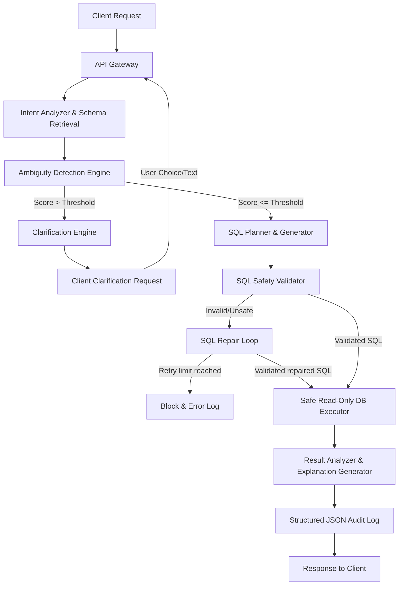

# QueryPilot Architectural Specification

This document details the software architecture, modular services, data flows, and security boundaries of **QueryPilot — Intelligent Text-to-SQL with Ambiguity Resolution**.

---

## 1. Pipeline Overview

QueryPilot uses a modular, multi-layered pipeline architecture. Instead of passing user questions directly to an LLM to generate SQL, every request is inspected, contextually bound, safely validated, executed, and summarized before returning.



---

## 2. Component Design & Roles

### 2.1 API Gateway & Session Manager
- **API Entrypoint**: Formulated using **FastAPI** (`backend/app/main.py`), utilizing CORS controls and JWT token verification.
- **Session Manager** (`backend/app/services/clarification/manager.py`): Creates and tracks active sessions in the database. Manages dialogue histories to prevent infinite clarification loops.

### 2.2 Schema Intelligence Layer
- **Schema Extractor** (`backend/app/services/schema/extractor.py`): Inspects database catalogs dynamically. Extracts tables, column specifications, descriptions, and sample row lists.
- **Schema Graph** (`backend/app/services/schema/graph.py`): Models database entities as nodes and foreign keys as edges. Runs an undirected BFS shortest-path algorithm to retrieve a pruned database schema subset containing only the tables required for joins.
- **Metadata Cache** (`backend/app/services/schema/cache.py`): Implements local dictionary and Redis-backed cache serialized models of schemas.

### 2.3 Clarification Engine
- **Ambiguity Detector** (`backend/app/services/clarification/detector.py`): Feeds pruned schemas and business glossaries to the LLM to calculate an **Ambiguity Score** (0.0 to 1.0).
- If the score exceeds `AMBIGUITY_THRESHOLD` (default 0.70), the pipeline returns multiple-choice options or requests textual clarification.
- If dialog rounds exceed `MAX_CLARIFICATION_ROUNDS` (default 2), it applies the `suggested_safest_assumption` and proceeds.

### 2.4 Business Semantic Layer
- **Glossary Registry** (`backend/app/services/semantic/engine.py`): Allows administrators to define mappings between high-level business definitions and SQL formulas (e.g. `revenue` -> `SUM(quantity * price)`). Mappings are injected into LLM planner prompts at execution time.

### 2.5 SQL Generation & Safety Layer
- **SQL Generator** (`backend/app/services/sql/generator.py`): Uses structured LLM generation to write compliance PostgreSQL SELECT queries.
- **SQL Validator** (`backend/app/services/sql/validator.py`): Parses the SQL AST using `sqlglot`. Blocks non-SELECT queries, dangerous administration functions (e.g., `pg_sleep`), Cartesian joins, and queries accessing tables outside the allowlist.
- **SQL Repair Engine** (`backend/app/services/sql/repair.py`): Re-submits syntax errors or validation violations back to the LLM for corrections up to `MAX_REPAIR_ATTEMPTS` times.

### 2.6 DB Executor & Summarizer
- **Database Executor** (`backend/app/services/executor/postgres.py`): Runs queries against PostgreSQL target database. Restricts statement execution times using session-level `statement_timeout` parameters and caps returned rows (default 500).
- **Result Summarizer** (`backend/app/services/analyzer/summarizer.py`): Formulates text summaries, highlights insights, and checks for outliers based solely on the returned data. Hallucination prevention instructions ensure zero fictional facts.

---

## 3. Data Flow Model

```
User Query
   |
[Intent Analyzer] -> BFS Graph Search -> Active Schema Tables
   |
[Ambiguity Detector] -> Score: 0.85 -> active (clarify options card)
   |
User Clicks Card -> Score: 0.15 -> resolved
   |
[SQL Planner] -> Generates SQLPlan -> Parse AST (sqlglot)
   |
[SQL Validator] -> Check tables/columns, joins & write blockages
   |
[DB Executor] -> Read-only connection (statement_timeout)
   |
[Result Summarizer] -> JSON audit save -> UI rendering (Tabular + Recharts)
```

---

## 4. Database Privilege Segregation

QueryPilot uses a strict database security topology to enforce Least Privilege:

1. **Application Database** (`querypilot_app`): Read-write database connection string storing configuration settings, user accounts, audit trails, and semantic layer mappings.
2. **Execution Target Database** (`querypilot_execution`):
   - **Admin connection**: Used during startup to create sample schemas and seed mockup data.
   - **ReadOnly connection** (`querypilot_ro`): Used by the LLM execution pipeline. This user has SELECT privileges only. INSERT, UPDATE, DELETE, and DDL permissions are blocked at the database engine level.
