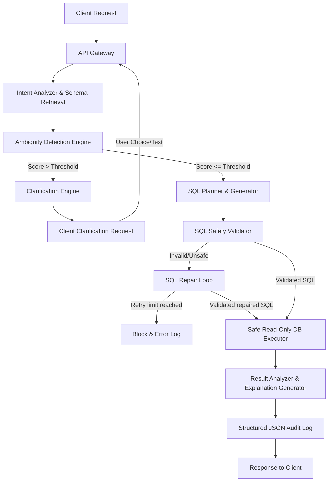

# QueryPilot — Intelligent Text-to-SQL with Ambiguity Resolution

QueryPilot is a state-of-the-art **Intelligent Text-to-SQL platform** designed to safely and precisely translate natural language business questions into optimized, compliant SQL queries. 

Unlike naive translation interfaces, QueryPilot incorporates an **Advanced Clarification Engine** that dynamically calculates ambiguity scores, requests user clarifications when questions are underspecified, validates query ASTs to enforce read-only execution security boundaries, and repairs syntax/schema mismatches automatically.

---

## 📸 Interface Preview

### 1. Disambiguation Workspace
An interactive workspace supporting multi-turn conversation dialogue, real-time ambiguity card resolution, dynamic query metrics, natural-language explanation summaries, and interactive chart visualizations (`recharts`).


### 2. Evaluation & Benchmark Report
Audits platform correctness, security safety blocking rates, and clarification precision against a comprehensive 100-question test suite.


---

## 🛠️ Architecture Pipeline



For a comprehensive specifications breakdown, refer to the [ARCHITECTURE.md](ARCHITECTURE.md) manual.

---

## 🚀 Getting Started

### Prerequisites
- Python `3.12+`
- Node.js `18+` (npm `9+`)

### 1. Backend Server Setup
1. Navigate into the backend directory:
   ```bash
   cd backend
   ```
2. Create and activate a virtual environment (recommended):
   ```bash
   python -m venv venv
   source venv/bin/activate  # On Windows: venv\Scripts\activate
   ```
3. Install dependencies:
   ```bash
   pip install -r requirements.txt
   ```
4. Copy the environment template and configure keys if using live LLM providers (falls back to a mock provider by default):
   ```bash
   cp .env.example .env
   ```
5. Initialize and seed databases:
   ```bash
   python app/setup_sample_db.py
   ```
6. Spin up the FastAPI server:
   ```bash
   uvicorn app.main:app --reload --host 0.0.0.0 --port 8000
   ```

### 2. Frontend Web UI Setup
1. Navigate into the frontend directory:
   ```bash
   cd frontend
   ```
2. Install npm modules:
   ```bash
   npm install
   ```
3. Start the Next.js development server:
   ```bash
   npm run dev
   ```
4. Open your browser and navigate to: `http://localhost:3000`

---

## 🧪 Testing & Benchmark Evaluations

### 1. Pytest Unit Suite
Validate core database handlers, schema pruners, semantics mapping, tokenizers, and security blocking rules:
```bash
# In the workspace root
pytest
```

### 2. Pipeline Evaluations Benchmark
Run the end-to-end 100-question pipeline test suite (including SQL injections, temporal operations, and multi-hop queries):
```bash
# In the workspace root
python evaluate.py
```
*Outputs JSON and HTML dashboards directly inside the `reports/` folder.*

---

## 🔒 Security Topology (Least Privilege)
QueryPilot segregates database contexts:
- **Application Settings DB (`querypilot_app`)**: Read-write connection holding configurations, credentials, audit trails, and semantic layer registry mappings.
- **Execution Target DB (`querypilot_execution`)**: Managed with two users:
  - **Admin user**: Seeds mock e-commerce tables on bootstrap.
  - **Read-Only user (`querypilot_ro`)**: Used by the query execution engine. SELECT privileges only; INSERT, UPDATE, DELETE, and DDL commands are completely blocked at the engine level.
